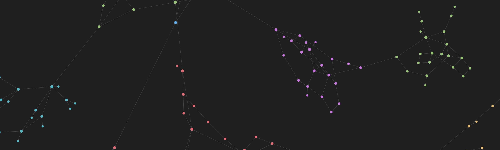

# graph

Live at [graph.isaacchacko.com](https://graph.isaacchacko.com).

I like how Obsidian's graph view looks and moves, so I rebuilt it clean-room, from how it behaves rather than from its code. Then I put an editor on top so I have a quick way to render nice-looking graphs for CS work: strongly connected components, BFS layers, weighted shortest-path graphs, dependency DAGs.

Type links or draw them on the canvas, let the layout settle, then export a PNG or SVG or share a link.

```
graph -> renderer, website
renderer -> physics, camera, labels
Sun {gold 3} -> Earth -> Moon
```

## Layout

| Path | What it is |
| --- | --- |
| `packages/graph-view` | [`graph-view`](packages/graph-view/README.md): the renderer and the language as a package: a dependency-free canvas renderer, a React component and a `<graph-view>` tag |
| `apps/web` | Next.js + shadcn/ui site: one left drawer holding the source editor, Obsidian-style graph settings, themes, PNG/SVG export and share links |

```sh
pnpm install
pnpm dev          # http://localhost:3000 (also builds the <script> bundle)
pnpm test         # renderer physics + parser
pnpm typecheck
```

## Use it in your own page

Everything the site draws comes from the [`graph-view`](packages/graph-view/README.md) package, which works anywhere:

```html
<script src="https://graph.isaacchacko.com/graph-view.js"></script>

<graph-view arrows>
  graph -> renderer, website
  Sun {gold 3} -> Earth -> Moon
</graph-view>
```

```tsx
import { Graph } from "graph-view/react";

<Graph source="A -> B, C" theme="light" onNodeClick={({ id }) => console.log(id)} />;
```

```ts
import { GraphRenderer, parseGraph } from "graph-view";

const graph = new GraphRenderer(container, { arrows: true });
graph.setData(parseGraph("A -> B -> C").data);
```

Or skip code entirely: *Export & share → Copy embed code* gives an `<iframe>` of any graph (`/embed`). The [package README](packages/graph-view/README.md) has every prop, option and event.

### How the renderer behaves

- **Physics**: a cooling ("alpha") force simulation with Barnes–Hut repulsion, degree-weighted link springs and a centre pull, tuned through the same four knobs Obsidian exposes (center, repel, link force, link distance). It goes idle once settled, so nothing renders while the graph is still.
- **Stable updates**: `setData` keeps the positions of surviving nodes and seeds new ones next to a linked neighbour, so editing never reshuffles the graph. A brand-new graph starts packed tight and unfolds, which untangles far better than a wide random start.
- **Interaction**: hover a node to dim everything outside its neighbourhood, with the hovered node and its links in the accent colour. In `select` mode (the default) dragging moves nodes; in `edit` mode dragging from a node draws a link (red and half-transparent until it is over another node, which emits `connect`). Double-click a node and keep holding to drag it. Clicking a link emits `linkClick` and clicking empty canvas emits `backgroundClick`. Pan, and wheel or pinch to zoom about the cursor.
- **Labels** fade in with zoom past a threshold, and labels in the focused neighbourhood are always shown.
- **Display**: node size grows with degree. Arrows, node size, link thickness and text size are all adjustable, and colours come from a `Theme`.
- **Extras**: `replay()` rebuilds the graph node by node (Obsidian's "Animate"). `toPNG()` and `toSVG()` export the graph cropped to its bounds. `setInsets()` keeps framing clear of overlaid UI.

## The language

| Syntax | Meaning |
| --- | --- |
| `A -> B` | link (`<-` reverses, `--` undirected, `<->` both ways) |
| `A -(3)-> B` | weighted link, shown at its midpoint (works on every arrow: `-(3)-`, `<-(3)-`, …) |
| `A -> B, C` | fan out |
| `A -> B -> C` | chain |
| `A {red 2}` | colour and size, wherever the node appears |
| `"Acme, Inc."` | quote names containing `,` `{` `}` or arrows |
| `# …` / `// …` | comments |

## Editing on the canvas

The text is the source of truth, and canvas edits rewrite it in place. The toolbar beside the drawer toggle switches modes, and hovering any control shows its shortcut:

| Key | Does |
| --- | --- |
| `S` | Select mode: drag nodes, drag the background to pan |
| `E` | Edit mode: click empty space for a new node, drag node→node for an edge |
| `Esc` | Show/hide the options drawer (or clear the selection first) |
| `⌘Z` / `⇧⌘Z` | Undo / redo every change, from canvas edits to slider drags (Ctrl on other platforms) |
| `F`, `+`, `-` | Fit, zoom in, zoom out |

New nodes take the next free fruit name (Apple, Banana, … Zucchini, then Apple2). In edit mode:

- **Click a node or edge** to select it, and every place it is written in the source is highlighted. **Type** to rename the node (every mention changes as you type) or to weigh the edge (`A -> B` becomes `A -(5)-> B`). `Enter` edits the current value, and an emptied name falls back to the next free fruit.
- **`⌫` or right-click** deletes it. Deleting a node removes its edges but not its neighbours. Deleting an edge keeps both nodes, and cuts chains and fan-outs apart in the source as needed.
- **Shift-drag** draws a box. The boxed nodes can only be bulk-deleted (`⌫`, or right-click one of them).
- **Double-click and hold** a node to move it without leaving edit mode.

## CS tools

*Display → Colour by* colours nodes by connected component, strongly connected component (Tarjan; nodes on no cycle stay plain), BFS depth or degree. *Weights set edge length* makes numerically weighted edges relax toward lengths proportional to their weights. Templates include a weighted shortest-path graph, SCCs, a course-prerequisite DAG, a binary tree, the Petersen graph, a grid and K7.

Coming later: settings presets for common views, and more CS tooling such as stepping through algorithms (BFS/DFS, Dijkstra, Bellman–Ford, Tarjan, topological sort) on the canvas.

## Themes

Vault (the default, modelled on Obsidian's dark graph view), Paper, Midnight, Rosé, Forest, Blueprint and Ink.

## Clean-room note

This is an independent implementation of the *behaviour* of Obsidian's graph view: how it looks and responds, as observable by any user of the app. No Obsidian source code, bundles or assets were read, decompiled or copied. The physics follow the standard published force-directed techniques (spring embedders, Barnes–Hut approximation), and every line here was written from scratch. "Obsidian" is a trademark of Dynalist Inc. This project is not affiliated with or endorsed by them.
